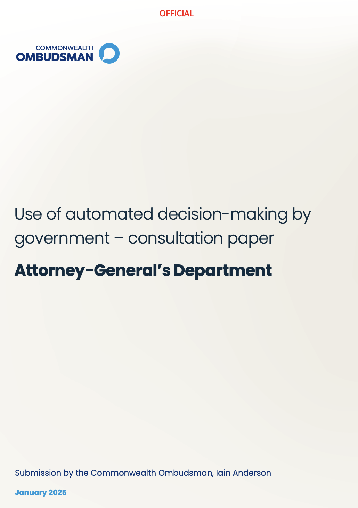
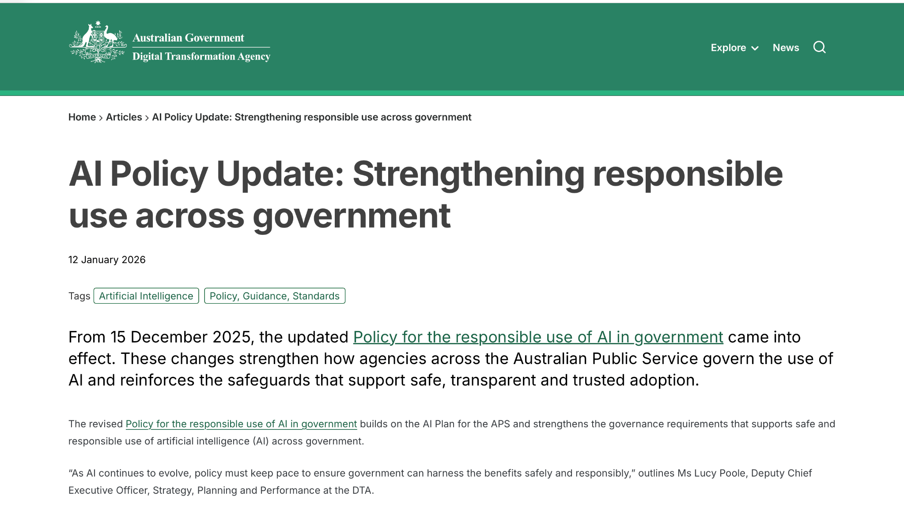
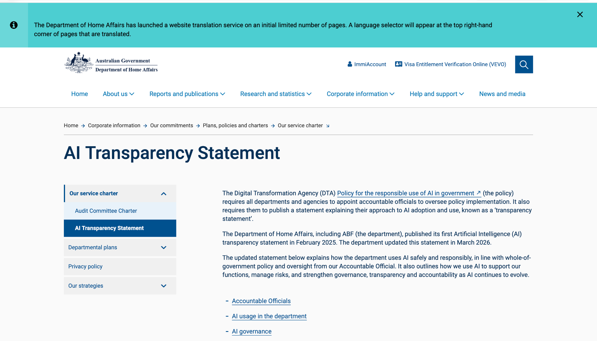
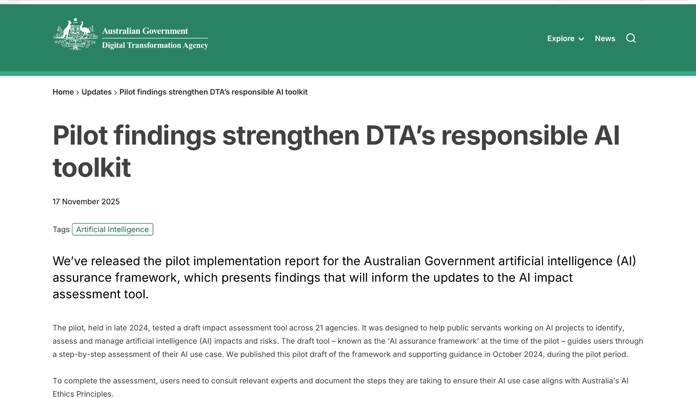

# COIT11223 – ICT Ethics and Governance in Society
## Assessment 3, Question 2: Automated Decision-Making in Government Systems

**Student:** Moazzam Inayatali Saiyed  
**Student ID:** 12318567

## Introduction

Automated decision-making (ADM) means using computer systems to make, or help people make, decisions using data, rules or algorithms. ADM is not automatically artificial intelligence (AI): software can apply fixed eligibility rules without learning from data. Governments use ADM to process large numbers of decisions quickly and consistently. However, people cannot always choose not to use these systems, and in areas such as welfare, immigration and public services a wrong decision can affect someone's money, opportunities and wellbeing. That creates a responsibility to test whether decisions are lawful, accurate, understandable and reviewable.

As a future ICT professional I may build, test or approve systems like these. The ACS Code of Professional Conduct puts the public interest first (Australian Computer Society 2014), and the ethical theories from Week 4, including Kantianism, utilitarianism and social contract theory (Quinn 2020), give me ways to judge whether a system treats people fairly.

Before this unit, I assumed that decisions made by computers were generally more objective and fair than decisions made by people. Through the six artefacts below, which cover Australia and the Netherlands, I learned that automation moves human choices into the design of rules and data, and that fairness depends on testing, explanation and a real way to appeal. A question runs through the portfolio: does faster processing count as progress if an affected person cannot understand or correct an error?

## Artefact 1 – Independent oversight of government ADM

**Artefact:** Commonwealth Ombudsman, submission on the use of automated decision-making by government (January 2025)  
**Source:** [Use of automated decision-making by government – consultation submission](https://www.ombudsman.gov.au/__data/assets/pdf_file/0024/317166/Use-of-automated-decision-making-by-government-consultation-paper-submission.pdf)

*Figure 1: Cover page of the Commonwealth Ombudsman submission on automated decision-making by government (Commonwealth Ombudsman 2025).*

The Commonwealth Ombudsman (2025) responded in January 2025 to the Attorney-General's Department consultation on government use of automated decision-making. The submission discusses how the pursuit of efficiency in statutory decisions must be balanced by genuine human review, oversight and transparency, so affected people can understand and question outcomes.

Before this unit I assumed a computer-made decision was more objective than a human one. I chose this submission because it comes from an independent oversight body, not a department promoting its own systems. It links to social contract theory: citizens accept government authority when decisions are fair and open to challenge (Quinn 2020). It also reflects the ACS value of the public interest (Australian Computer Society 2014). It changed my view because an official who simply accepts a computer's output is not really making a decision.

## Artefact 2 – Australia's updated responsible AI policy

**Artefact:** Digital Transformation Agency, policy update (12 January 2026)  
**Source:** [AI policy update: strengthening responsible use across government](https://www.dta.gov.au/articles/ai-policy-update-strengthening-responsible-use-across-government)

*Figure 2: Screenshot of the Digital Transformation Agency article “AI Policy Update: Strengthening responsible use across government” (Digital Transformation Agency 2026).*

The Digital Transformation Agency (2026) explains the updated Policy for the responsible use of AI in government, which took effect in December 2025. It requires accountable officials, registers of AI use cases, incident processes and assessments covering fairness, safety, privacy and transparency, with requirements phased in during 2026.

I chose it because it shows Australia's response after Robodebt, where debts were raised through automated income averaging and many people were harmed (Royal Commission into the Robodebt Scheme 2023). From a utilitarian view, faster services matter only if harms are assessed instead of assumed away (Quinn 2020). However, a named official cannot guarantee fair outcomes, so I would want independent testing for group differences before launch.

## Artefact 3 – Algorithm oversight in the Netherlands

**Artefact:** Autoriteit Persoonsgegevens (Dutch Data Protection Authority), AI & Algorithms Netherlands, fifth edition (July 2025)  
**Source:** [Report AI & Algorithms Netherlands – Fifth edition](https://www.autoriteitpersoonsgegevens.nl/en/system/files?file=2025-09%2FReport+AI+%26+Algorithms+Netherlands+-+fifth+edition+RAN+July+2025.pdf)

*Figure 3: Cover of the report *AI & Algorithms Netherlands: Fifth edition* (Autoriteit Persoonsgegevens 2025).*

The Dutch Data Protection Authority (Autoriteit Persoonsgegevens 2025) published the fifth edition of its AI and algorithms report in July 2025. It examines the opportunities and risks of algorithms, including fundamental rights, algorithm registration and oversight, and notes doubts about some AI uses such as emotion recognition.

I included it to look beyond Australia. The Dutch childcare benefits scandal, where a risk-profiling system used nationality as a risk factor (Amnesty International 2021), is a separate earlier event, but it explains why this regulator watches algorithms closely. Kantianism applies because people should not be reduced to risk scores (Quinn 2020). If a system labelled me high risk, I would expect reasons, a way to correct errors and a human review.

## Artefact 4 – Impact assessment before deployment

**Artefact:** Digital Transformation Agency, media release (2 December 2025)  
**Source:** [AI policy overhauled with new impact assessment tool and procurement guidance](https://www.dta.gov.au/media-releases/ai-policy-overhauled-new-impact-assessment-tool-and-procurement-guidance)

*Figure 4: Screenshot of the Digital Transformation Agency media release announcing a new AI impact assessment tool and procurement guidance (Digital Transformation Agency 2025a).*

On 2 December 2025 the Digital Transformation Agency (2025a) announced an updated AI policy, a new AI impact assessment tool and guidance on AI procurement. The tool helps teams identify and manage impacts and risks against Australia's AI Ethics Principles, and is intended to complement, not replace, existing frameworks and laws.

I chose this because it connects ethics to real ICT work before launch. If I found unresolved fairness concerns on a project, I would document them, ask for more testing and escalate, because the ACS value of competence means working diligently, not only meeting a specification (Australian Computer Society 2014). That could delay delivery, but a system can meet its technical requirements and still apply an unfair rule, so I would not treat possible harm as a technical detail.

## Artefact 5 – Transparency in a real Australian department

**Artefact:** Department of Home Affairs, AI transparency statement (updated March 2026)  
**Source:** [AI transparency statement](https://www.homeaffairs.gov.au/access-and-accountability/our-commitments/plans-and-charters/our-service-charters/ai-transparency-statement)

*Figure 5: Screenshot of the Department of Home Affairs AI Transparency Statement webpage (Department of Home Affairs 2026).*

The Department of Home Affairs (2026) updated its AI transparency statement in March 2026, after first publishing one in February 2025. The statement explains how the department uses AI in line with whole-of-government policy, with oversight from an Accountable Official, and outlines its approach to managing risk and strengthening governance, transparency and accountability.

I chose it because it shows what transparency looks like in a department whose decisions affect people's lives. A statement is useful evidence of a commitment, but it does not tell a person what information was used in their own case. The ACS value of honesty means being open about how systems work (Australian Computer Society 2014). I would also want a clear explanation and a practical route to seek review of an automated outcome.

## Artefact 6 – Testing governance in practice

**Artefact:** Digital Transformation Agency, pilot findings (17 November 2025)  
**Source:** [Pilot findings strengthen DTA's responsible AI toolkit](https://www.dta.gov.au/updates/pilot-findings-strengthen-dtas-responsible-ai-toolkit)

*Figure 6: Screenshot of the Digital Transformation Agency update “Pilot findings strengthen DTA’s responsible AI toolkit” (Digital Transformation Agency 2025b).*

The Digital Transformation Agency (2025b) reported on a pilot held from September to November 2024, in which 21 agencies tested a draft impact assessment tool, then called the AI assurance framework. The findings will shape the updated tool, and the pilot found the draft gave a strong foundation for assessing the risks of AI use cases.

I chose it because it shows governance being tested in practice, not just written down. As a future ICT professional, I would check data quality and compare outcomes across groups in similar circumstances before release. This connects to Kantian respect for people and utilitarian attention to harm (Quinn 2020). The healthcare AI scenario in Assessment 3 highlights the risk: a system can meet its specification while an unfair pattern remains unresolved. Testing is therefore an ethical duty.

## Connecting the artefacts: Australia and the Netherlands

Across the six artefacts, the main lesson is the difference between having rules and showing that they work. Australia has strengthened its requirements for accountable officials, registers, transparency statements and impact assessments, while the Dutch regulator stresses fundamental rights, algorithm registration and oversight. Robodebt in Australia (Royal Commission into the Robodebt Scheme 2023) and the earlier Dutch childcare benefits scandal (Amnesty International 2021) are warnings about what happens when automated processes are unreliable, discriminatory or hard to challenge. They involved different agencies, systems and laws, so I do not treat them as identical, and I treat them as historical context, not as 2025–2026 artefacts.

These cases also show that ADM is not the same as AI. An unfair fixed rule can cause harm without any machine learning. Publishing a policy or transparency statement is a start, but I think people are best protected by a combination of quality data, testing across affected groups, clear explanations, accessible appeals, human review and independent oversight.

## Reflection on learning and professional practice

The unit topics built on each other for me. The Week 4 ethical theories showed that Kantianism, utilitarianism and social contract theory ask different questions about the same decision (Quinn 2020). The Week 5 discussion of professional responsibility reminded me that an ICT professional answers to the public, not only to an employer (Australian Computer Society 2014). The Week 8 privacy and Week 10 legal topics linked these ideas to personal information, government power and the harm seen in Robodebt.

My main conclusion is that calling a system efficient or accurate is not a complete ethical argument. The idea I find most useful is Kant's principle of not treating people merely as a means (Quinn 2020), because in government services people usually cannot opt out of the system that judges them. In my future ICT work I would check data quality, test for unfair differences between groups, document concerns honestly, and make sure people can ask for a genuine human review.

## AI use declaration

I used AI tools  for planning and research: finding possible artefacts, organising the structure, early ideas and checking facts. I captured the screenshots of the source artefacts myself, checked the sources and links, and edited the reflections so they state my own views.

## References

Amnesty International 2021, *Xenophobic machines: discrimination through unregulated use of algorithms in the Dutch childcare benefits scandal*, 25 October, viewed 7 October 2026, https://www.amnesty.nl/actueel/xenophobic-machines-discrimination-through-unregulated-use-of-algorithms-in-the-dutch-childcare-benefits-scandal

Australian Computer Society 2014, *ACS Code of Professional Conduct*, version 2.1, viewed 7 October 2026, https://www.acs.org.au/content/dam/acs/rules-and-regulations/Code-of-Professional-Conduct_v2.1.pdf

Autoriteit Persoonsgegevens 2025, *Report AI & Algorithms Netherlands: fifth edition*, July, viewed 7 October 2026, https://www.autoriteitpersoonsgegevens.nl/en/system/files?file=2025-09%2FReport+AI+%26+Algorithms+Netherlands+-+fifth+edition+RAN+July+2025.pdf

Commonwealth Ombudsman 2025, *Use of automated decision-making by government: consultation paper submission*, January, viewed 7 October 2026, https://www.ombudsman.gov.au/__data/assets/pdf_file/0024/317166/Use-of-automated-decision-making-by-government-consultation-paper-submission.pdf

Department of Home Affairs 2026, *AI transparency statement*, updated March, viewed 7 October 2026, https://www.homeaffairs.gov.au/access-and-accountability/our-commitments/plans-and-charters/our-service-charters/ai-transparency-statement

Digital Transformation Agency 2025a, *AI policy overhauled with new impact assessment tool and procurement guidance*, 2 December, viewed 7 October 2026, https://www.dta.gov.au/media-releases/ai-policy-overhauled-new-impact-assessment-tool-and-procurement-guidance

Digital Transformation Agency 2025b, *Pilot findings strengthen DTA's responsible AI toolkit*, 17 November, viewed 7 October 2026, https://www.dta.gov.au/updates/pilot-findings-strengthen-dtas-responsible-ai-toolkit

Digital Transformation Agency 2026, *AI policy update: strengthening responsible use across government*, 12 January, viewed 7 October 2026, https://www.dta.gov.au/articles/ai-policy-update-strengthening-responsible-use-across-government

Quinn, MJ 2020, *Ethics for the Information Age*, 8th edn, Pearson, United States.

Royal Commission into the Robodebt Scheme 2023, *Report of the Royal Commission into the Robodebt Scheme*, Commonwealth of Australia, 7 July, viewed 7 October 2026, https://robodebt.royalcommission.gov.au/publications/report
