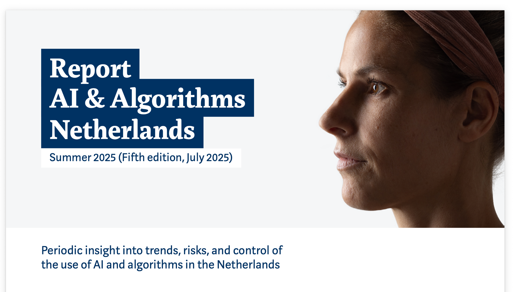
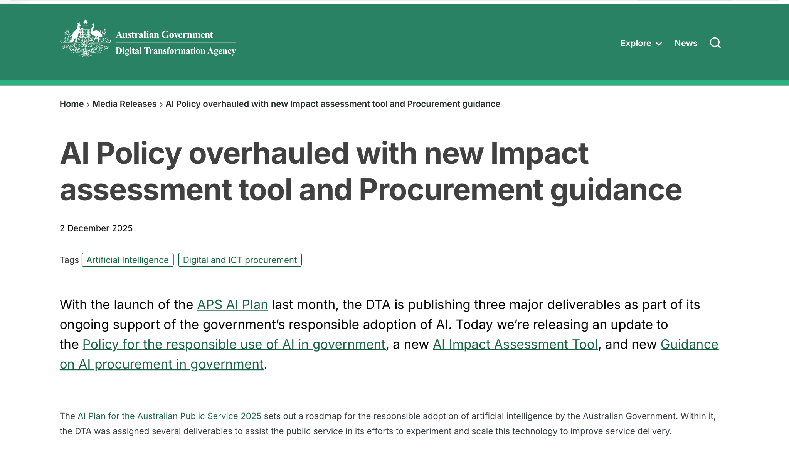

# COIT11223 – ICT Ethics and Governance in Society
## Assessment 3, Question 2: Automated Decision-Making in Government Systems

**Student:** Moazzam Inayatali Saiyed  
**Student ID:** 12318567

## Introduction

Automated decision-making (ADM) is when a computer system makes a decision or helps someone make one using data and set rules. It does not always involve artificial intelligence (AI); even a simple program checking eligibility against fixed criteria is a form of automation. I can understand why governments use these systems. They have thousands of applications to process, and computers can save time. But if the information or rules are wrong, the result might affect someone's payments, visa or access to a service. That is why accuracy alone is not enough: people also need to understand decisions and be able to question them.

This matters to me as an ICT student because I could one day help develop or test software used for these decisions. The ACS Code of Professional Conduct says the public interest comes first (Australian Computer Society 2014). The ethical theories from Week 4 also help me look at the issue from different angles instead of simply asking whether the software works (Quinn 2020).

The starting view described in my portfolio is that computer-made decisions seem more objective than human decisions. Looking at Australia and the Netherlands has made me question that idea. People still choose the data, design the rules and decide when to trust the result. What stands out to me now is the need for testing, clear explanations and a proper appeal process. A faster decision is not necessarily a better one if the person affected cannot get an error fixed.

## Artefact 1 – Independent oversight of government ADM

**Artefact:** Commonwealth Ombudsman, submission on the use of automated decision-making by government (January 2025)  
**Source:** [Use of automated decision-making by government – consultation submission](https://www.ombudsman.gov.au/__data/assets/pdf_file/0024/317166/Use-of-automated-decision-making-by-government-consultation-paper-submission.pdf)

*Figure 1: Cover page of the Commonwealth Ombudsman submission on automated decision-making by government (Commonwealth Ombudsman 2025).*

In January 2025, the Commonwealth Ombudsman responded to a government consultation about automated decisions. The main point I took from this submission is that saving time should not come at the cost of fair decisions. Even when a computer is involved, there still needs to be proper oversight and a way for someone to ask how a decision was reached (Commonwealth Ombudsman 2025).

I chose this source because it comes from an independent watchdog rather than an agency describing its own technology. It made me think about social contract theory, where the public should be able to expect fair treatment from government (Quinn 2020). It also relates to the ACS responsibility to put the public first (Australian Computer Society 2014). To me, a public servant should not simply accept a computer's answer without being able to explain or review it.

## Artefact 2 – Australia's updated responsible AI policy

**Artefact:** Digital Transformation Agency, policy update (12 January 2026)  
**Source:** [AI policy update: strengthening responsible use across government](https://www.dta.gov.au/articles/ai-policy-update-strengthening-responsible-use-across-government)

*Figure 2: Screenshot of the Digital Transformation Agency article “AI Policy Update: Strengthening responsible use across government” (Digital Transformation Agency 2026).*

The Digital Transformation Agency's 2026 article explains changes to Australia's government AI policy, which started in December 2025. The policy sets out measures such as accountable officials, records of where AI is used and checks for issues involving privacy, fairness and safety. Some requirements are being introduced gradually during 2026 rather than all at once (Digital Transformation Agency 2026).

I included this because it shows how government is trying to put responsibility around AI use. Robodebt is a reminder of what can happen when automated processes lead to harmful outcomes (Royal Commission into the Robodebt Scheme 2023). Utilitarianism made me consider both sides: faster services could help many people, but unfair decisions could hurt them too (Quinn 2020). I would want fairness testing as well as someone officially responsible for the system.

## Artefact 3 – Algorithm oversight in the Netherlands

**Artefact:** Autoriteit Persoonsgegevens (Dutch Data Protection Authority), AI & Algorithms Netherlands, fifth edition (July 2025)  
**Source:** [Report AI & Algorithms Netherlands – Fifth edition](https://www.autoriteitpersoonsgegevens.nl/en/system/files?file=2025-09%2FReport+AI+%26+Algorithms+Netherlands+-+fifth+edition+RAN+July+2025.pdf)

*Figure 3: Cover of the report *AI & Algorithms Netherlands: Fifth edition* (Autoriteit Persoonsgegevens 2025).*

The Dutch Data Protection Authority published its fifth report on AI and algorithms in July 2025. It looks at where algorithms may be useful but also raises concerns about fundamental rights, oversight and applications such as emotion recognition. I found it useful that the report treats these as social and legal questions, not just technical questions (Autoriteit Persoonsgegevens 2025).

I wanted to compare Australia's approach with another country. The earlier Dutch childcare benefits scandal shows how damaging unfair risk profiling can be (Amnesty International 2021). That case is different from this 2025 report, but it helps explain why strong oversight matters. Kantianism is relevant because a person should not be treated as just a risk score (Quinn 2020). I would expect an explanation and a chance to correct mistakes if a government system classified me unfairly.

## Artefact 4 – Impact assessment before deployment

**Artefact:** Digital Transformation Agency, media release (2 December 2025)  
**Source:** [AI policy overhauled with new impact assessment tool and procurement guidance](https://www.dta.gov.au/media-releases/ai-policy-overhauled-new-impact-assessment-tool-and-procurement-guidance)

*Figure 4: Screenshot of the Digital Transformation Agency media release announcing a new AI impact assessment tool and procurement guidance (Digital Transformation Agency 2025a).*

In December 2025, the Digital Transformation Agency announced a new AI impact assessment tool alongside policy and procurement guidance. The idea is to make teams think through possible risks before introducing AI. The tool supports existing legal and risk-management requirements; it does not replace them (Digital Transformation Agency 2025a).

This artefact feels especially relevant to ICT work because it is about decisions made before a system goes live. If testing showed possible unfairness, I would record the problem and ask for it to be investigated rather than ignore it to meet a deadline. The ACS Code's focus on competence supports taking that responsibility seriously (Australian Computer Society 2014). Software can follow every instruction correctly while the instructions themselves are unfair.

## Artefact 5 – Transparency in a real Australian department

**Artefact:** Department of Home Affairs, AI transparency statement (updated March 2026)  
**Source:** [AI transparency statement](https://www.homeaffairs.gov.au/access-and-accountability/our-commitments/plans-and-charters/our-service-charters/ai-transparency-statement)

*Figure 5: Screenshot of the Department of Home Affairs AI Transparency Statement webpage (Department of Home Affairs 2026).*

The Department of Home Affairs first published an AI transparency statement in February 2025 and updated it in March 2026. It explains the department's approach to using AI responsibly, including oversight by an accountable official and processes for managing risks (Department of Home Affairs 2026).

I chose this statement because departments such as Home Affairs make decisions that can seriously affect individuals. A public statement is helpful, but I do not think it is enough on its own. Someone affected by a decision may still need to know what information was used and whether it was correct. That connects with honesty in the ACS Code (Australian Computer Society 2014). A clear review process would matter more to me than a general promise of transparency.

## Artefact 6 – Testing governance in practice

**Artefact:** Digital Transformation Agency, pilot findings (17 November 2025)  
**Source:** [Pilot findings strengthen DTA's responsible AI toolkit](https://www.dta.gov.au/updates/pilot-findings-strengthen-dtas-responsible-ai-toolkit)

*Figure 6: Screenshot of the Digital Transformation Agency update “Pilot findings strengthen DTA’s responsible AI toolkit” (Digital Transformation Agency 2025b).*

This November 2025 DTA article reports on a trial of a draft AI assurance framework. During late 2024, 21 government agencies tested a process for identifying risks in AI projects. The findings were used to help improve the assessment tool (Digital Transformation Agency 2025b).

I included this example because it shows the difference between having an ethical policy and trying it out in real projects. If I were testing a government system, I would want to check the data and see whether people in similar situations receive consistent results. That links to Kantian respect for individuals and utilitarian concern about harm (Quinn 2020). It also reminds me of the healthcare AI assessment scenario: meeting a technical specification does not automatically make a decision fair.

## Connecting the artefacts: Australia and the Netherlands

Across the six artefacts, the main lesson is the difference between having rules and showing that they work. Australia has strengthened its requirements for accountable officials, registers, transparency statements and impact assessments, while the Dutch regulator stresses fundamental rights, algorithm registration and oversight. Robodebt in Australia (Royal Commission into the Robodebt Scheme 2023) and the earlier Dutch childcare benefits scandal (Amnesty International 2021) are warnings about what happens when automated processes are unreliable, discriminatory or hard to challenge. They involved different agencies, systems and laws, so I do not treat them as identical, and I treat them as historical context, not as 2025–2026 artefacts.

These cases also show that ADM is not the same as AI. An unfair fixed rule can cause harm without any machine learning. Publishing a policy or transparency statement is a start, but I think people are best protected by a combination of quality data, testing across affected groups, clear explanations, accessible appeals, human review and independent oversight.

## Reflection on learning and professional practice

The unit topics built on each other for me. The Week 4 ethical theories showed that Kantianism, utilitarianism and social contract theory ask different questions about the same decision (Quinn 2020). The Week 5 discussion of professional responsibility reminded me that an ICT professional answers to the public, not only to an employer (Australian Computer Society 2014). The Week 8 privacy and Week 10 legal topics linked these ideas to personal information, government power and the harm seen in Robodebt.

My main conclusion is that calling a system efficient or accurate is not a complete ethical argument. The idea I find most useful is Kant's principle of not treating people merely as a means (Quinn 2020), because in government services people usually cannot opt out of the system that judges them. In my future ICT work I would check data quality, test for unfair differences between groups, document concerns honestly, and make sure people can ask for a genuine human review.

## AI use declaration

ChatGPT assisted with researching possible sources, organising the portfolio and producing early drafts of the analysis and reflections.I understand that I need to check the research and make sure the reflections accurately represent my own views before submission.

## References

Amnesty International 2021, *Xenophobic machines: discrimination through unregulated use of algorithms in the Dutch childcare benefits scandal*, 25 October, viewed 7 October 2026, https://www.amnesty.nl/actueel/xenophobic-machines-discrimination-through-unregulated-use-of-algorithms-in-the-dutch-childcare-benefits-scandal

Australian Computer Society 2014, *ACS Code of Professional Conduct*, version 2.1, viewed 7 October 2026, https://www.acs.org.au/content/dam/acs/rules-and-regulations/Code-of-Professional-Conduct_v2.1.pdf

Autoriteit Persoonsgegevens 2025, *Report AI & Algorithms Netherlands: fifth edition*, July, viewed 7 October 2026, https://www.autoriteitpersoonsgegevens.nl/en/system/files?file=2025-09%2FReport+AI+%26+Algorithms+Netherlands+-+fifth+edition+RAN+July+2025.pdf

Commonwealth Ombudsman 2025, *Use of automated decision-making by government: consultation paper submission*, January, viewed 7 October 2026, https://www.ombudsman.gov.au/__data/assets/pdf_file/0024/317166/Use-of-automated-decision-making-by-government-consultation-paper-submission.pdf

Department of Home Affairs 2026, *AI transparency statement*, updated March, viewed 7 October 2026, https://www.homeaffairs.gov.au/access-and-accountability/our-commitments/plans-and-charters/our-service-charters/ai-transparency-statement

Digital Transformation Agency 2025a, *AI policy overhauled with new impact assessment tool and procurement guidance*, 2 December, viewed 7 October 2026, https://www.dta.gov.au/media-releases/ai-policy-overhauled-new-impact-assessment-tool-and-procurement-guidance

Digital Transformation Agency 2025b, *Pilot findings strengthen DTA's responsible AI toolkit*, 17 November, viewed 7 October 2026, https://www.dta.gov.au/updates/pilot-findings-strengthen-dtas-responsible-ai-toolkit

Digital Transformation Agency 2026, *AI policy update: strengthening responsible use across government*, 12 January, viewed 7 October 2026, https://www.dta.gov.au/articles/ai-policy-update-strengthening-responsible-use-across-government

Quinn, MJ 2020, *Ethics for the Information Age*, 8th edn, Pearson, United States.

Royal Commission into the Robodebt Scheme 2023, *Report of the Royal Commission into the Robodebt Scheme*, Commonwealth of Australia, 7 July, viewed 7 October 2026, https://robodebt.royalcommission.gov.au/publications/report
